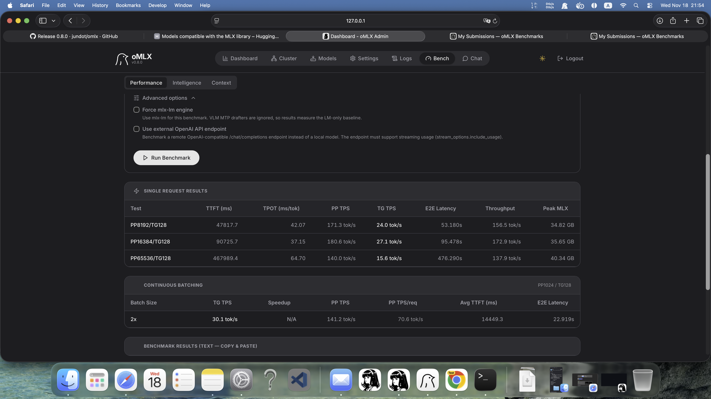
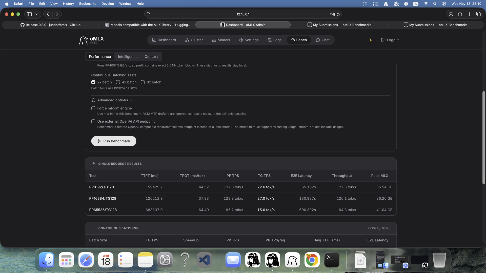
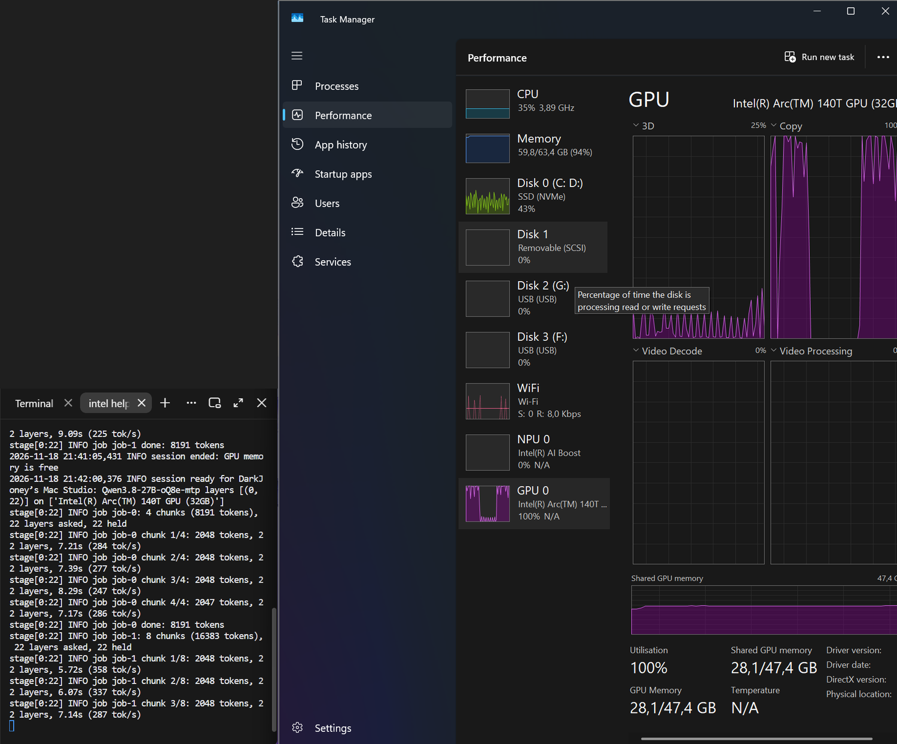
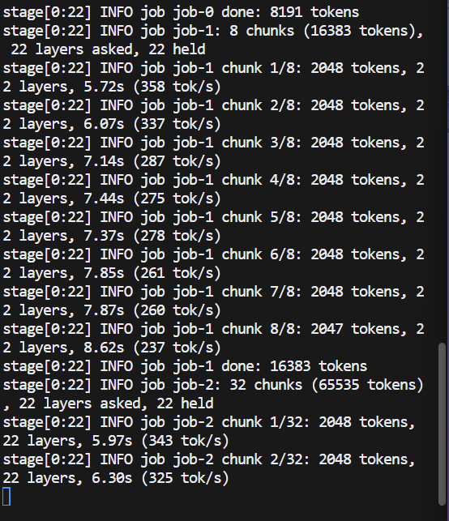
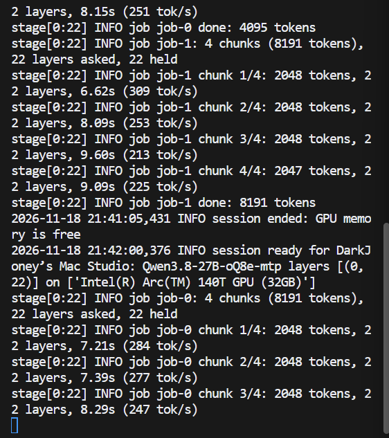
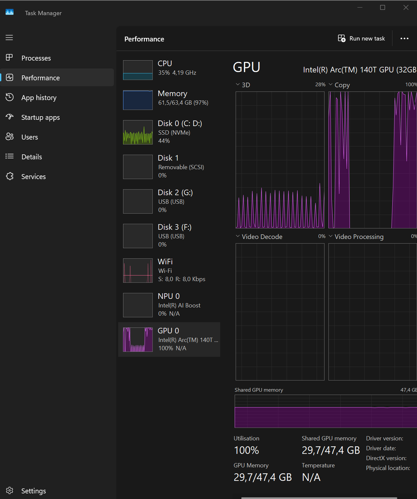
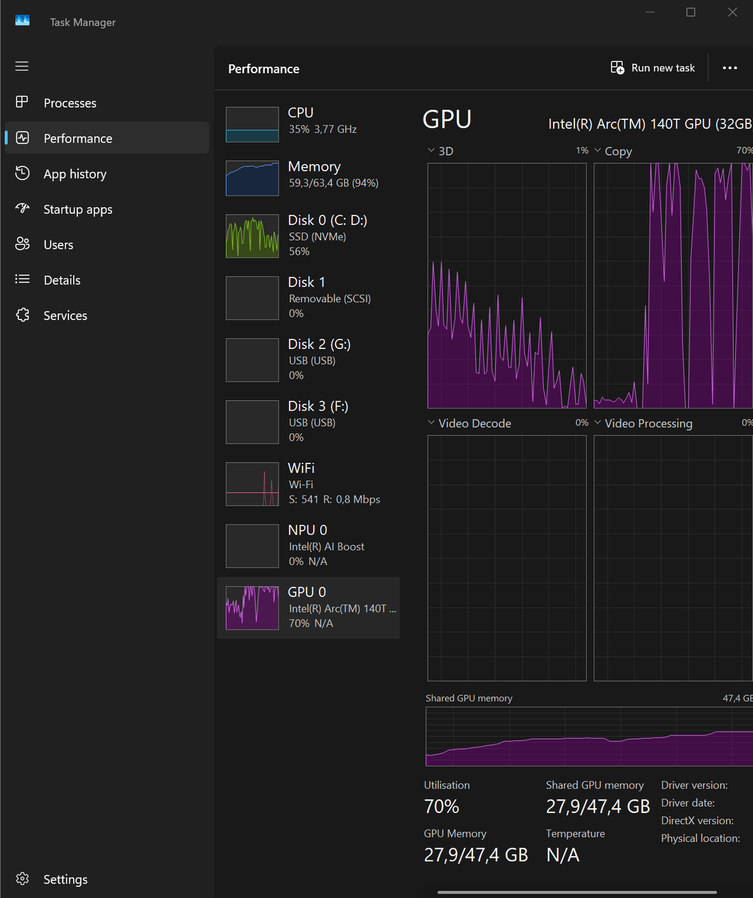
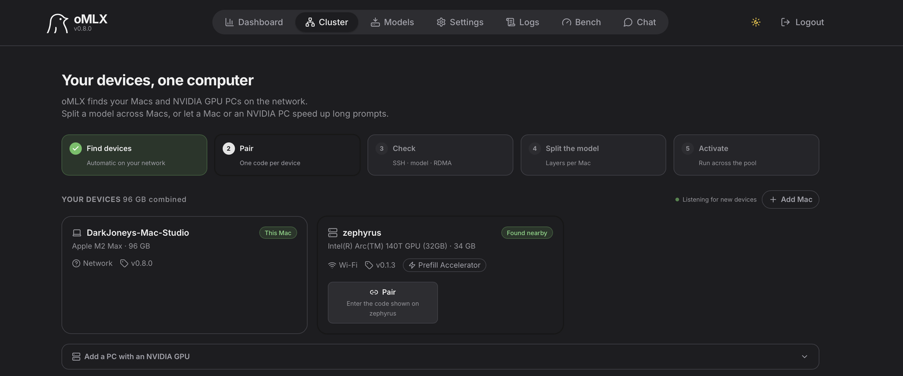
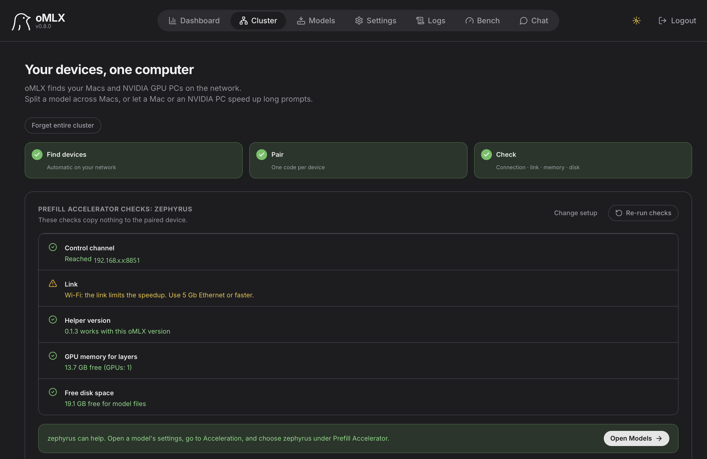
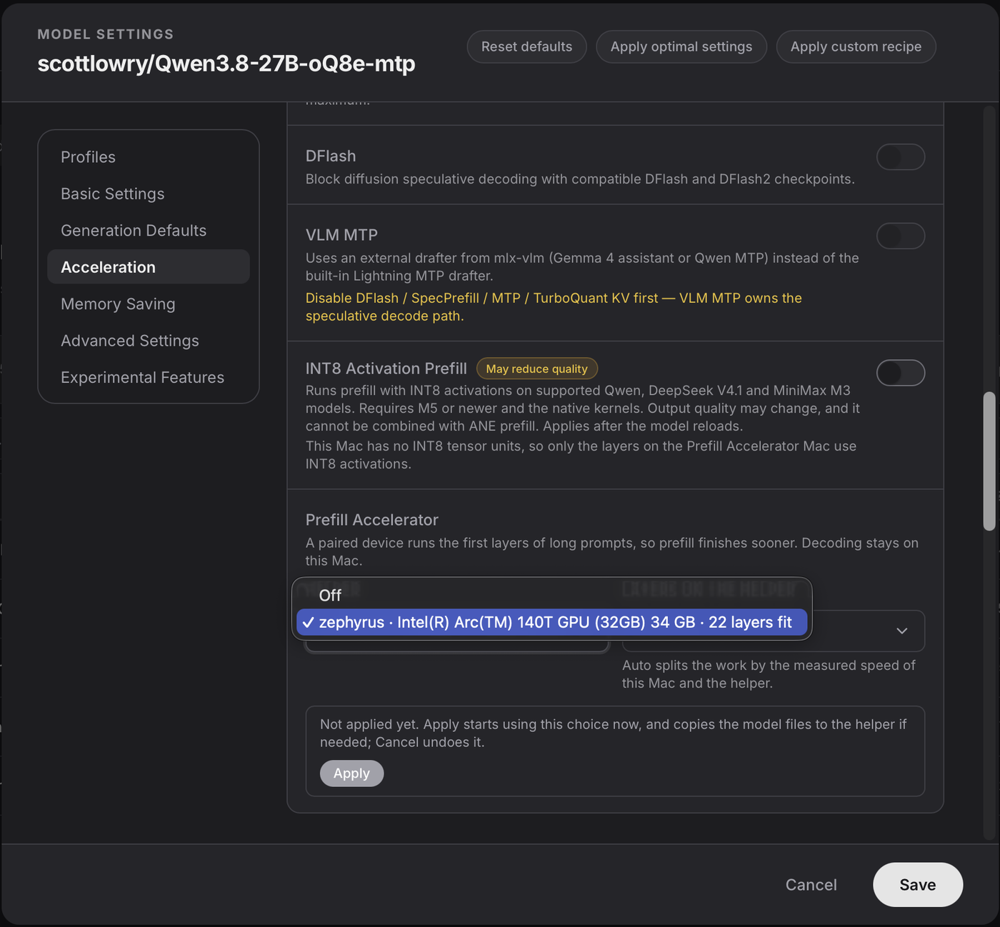

<h1 align="center">Archangel</h1>

<p align="center">
  <b>An Intel Arc GPU as a prefill accelerator for an Apple-silicon Mac.</b><br>
  <i>Proof of concept, under active development.</i><br>
  An experimental <a href="https://github.com/jundot/omlx">oMLX</a> helper for Intel Arc / Xe iGPUs with XMX,<br>
  the Intel counterpart of oMLX's <code>omlx-cuda-helper</code>.
</p>

<p align="center">
  
  
  
  
</p>

---

## Why

Because [oMLX](https://github.com/jundot/omlx) added a prefill-accelerator helper for NVIDIA GPUs,
and the obvious question is: why stick to the leather jacket?

A lot of people have an Intel GPU sitting idle: a laptop or a mini-PC with a Core Ultra and an Arc
iGPU that has real matrix units (XMX), plenty of shared memory and no CUDA. oMLX already splits the
work in a way that does not care what the helper is made of, as long as it speaks the protocol and
computes the same layers. So this repo is the Intel side of that protocol, written on PyTorch XPU.

## What it does

A long prompt is slow on a Mac because *prefill* (reading the prompt) is compute-bound, while
*decode* (writing the answer) is memory-bound. A Mac is great at the second and merely good at the
first.

Archangel lets a second machine with an Intel GPU run the **first layers** of the model for each
long prompt. The Mac keeps the whole model, the KV cache and the API; the helper computes layers
`[0, k)` in parallel with the Mac computing the rest, and sends back the boundary hidden state and
the cache rows. **Decoding stays on the Mac and is unchanged.**

```
 prompt ──► Mac (oMLX) ──────────── layers k..N ──► logits ──► tokens
              │  ▲
   chunks     │  │  hidden state + cache rows
              ▼  │
           Intel helper ── layers 0..k  (this repo)
```

## Measured result

One run on real hardware, same model, same benchmark, with and without the helper.

|  | Mac alone | Mac + Arc 140T | Speedup |
|---|---:|---:|---:|
| Prefill 8k   | 137.8 tok/s | **171.3 tok/s** | **+24 %** |
| Prefill 16k  | 129.8 tok/s | **180.6 tok/s** | **+39 %** |
| Prefill 64k  |  95.2 tok/s | **140.0 tok/s** | **+47 %** |
| Decode       | 22.6 / 27.0 / 15.6 tok/s | 24.0 / 27.1 / 15.6 tok/s | unchanged |

Qwen3.8-27B (`oQ8e`, 8-bit) · Mac Studio M2 Max (38-core GPU) · helper: Core Ultra 9 285H with the
Arc 140T iGPU, 22 of 64 layers on the helper. Both machines were connected **over Wi-Fi 7 in MLO
mode through a GL.iNet Flint 3 router**, no cable.

The oMLX Bench pages the numbers come from:

| Mac + Arc 140T helper | Mac alone (baseline) |
|---|---|
|  |  |

**One moment, both machines' evidence on a single screen** (Windows, Intel machine): the helper
log creates the session on `Intel(R) Arc(TM) 140T GPU (32GB)` and runs 2048-token chunks, while
Task Manager shows **GPU 0, Intel(R) Arc(TM) 140T, at 100 % utilisation**.



The helper's own log during a job (22 layers, 2048-token chunks):

| Chunks of a 16k and a 64k job | Session on the Arc 140T, then a job |
|---|---|
|  |  |

The right-hand log shows the session being created on `Intel(R) Arc(TM) 140T GPU (32GB)`.

Windows Task Manager on the Intel machine while the Mac is prefilling: **GPU 0, Intel(R) Arc(TM)
140T, at 100 %** (left) and at 70 % (right); compute on the 3D engine, weights and cache traffic on
the Copy engine.

| Arc 140T at 100 % | Arc 140T at 70 % |
|---|---|
|  |  |

## oMLX sees the Intel GPU

The helper announces itself by mDNS and shows up in oMLX's *Cluster* tab as a device with a
*Prefill Accelerator* badge. After pairing with a code, oMLX runs its checks, and the model's
*Acceleration* settings list the helper together with how many layers fit in its GPU memory.

| 1. Found nearby | 2. Paired, checks pass |
|---|---|
|  |  |



The *Link* warning in the second screenshot is oMLX being honest about Wi-Fi; the measurements
here were taken over Wi-Fi 7.

More detail, and what these numbers do **not** show, in [docs/RESULTS.md](docs/RESULTS.md).

## Status

| Part | State |
|---|---|
| Wire protocol, pairing, discovery, model copy | Works with oMLX 0.8.0 (shared with the CUDA helper) |
| `qwen3_5` family (Qwen3.5 / 3.6 / 3.8 dense, e.g. 27B) | **Works end to end**, benchmarked above |
| `qwen4_exp` family (Qwen3.8 Flash-Next) | Ported and matches the Mac-recorded fixtures on a tiny model; **never run on a real model** |
| Output equivalence on a real model | Not yet compared (greedy, same seed) |
| Windows, Ubuntu | Developed on Windows; Ubuntu scripts are written but untested |

**This is a proof of concept (PoC).** It is under active development and I will keep improving it.
So far only **Qwen3.8 27B** (`qwen3_5`) has been tested on real hardware; everything else (Flash-Next,
other quantizations, Ubuntu) is untested. Expect rough edges.

## Quick start

```bash
# on the Intel machine (Windows or Linux)
pip install torch --index-url https://download.pytorch.org/whl/xpu
pip install numpy zeroconf psutil safetensors tokenizers
pip install -e intel-helper/helper
python -m omlx_intel_helper.cli --state-dir ~/.omlx-intel-helper serve --name my-intel-pc
```

On the Mac: oMLX admin → *Settings → Advanced → Enable Distributed Inference*, restart, open the
*Cluster* tab, pair with the 6-digit code from the helper log, then per model:
*Acceleration → Prefill Accelerator*. Details, ports and first-run checklist:
[docs/FIRST_RUN.md](docs/FIRST_RUN.md), [intel-helper/helper/README.md](intel-helper/helper/README.md).

## Repository

```
intel-helper/
  helper/        the daemon and the stages (PyTorch XPU), tests, deploy scripts
  xcheck/        cross-check of the stage against real mlx-vlm on MLX CPU
  bench/         GEMM and attention micro-benchmarks used to make design decisions
docs/            results with screenshots, first-run checklist
```

## How it was checked

- the stages reproduce the outputs **recorded on a real Mac** with oMLX (contract fixtures);
- float32 results match the real `mlx-vlm` model to a relative error of ~5·10⁻⁶ at any chunking;
- a real helper worker process, started through oMLX's own host code, serves those fixtures over TCP;
- 4-bit packed weights give the same result as their dense twin.

Run the tests: `pytest intel-helper/helper/tests` (on Linux/WSL with the oMLX source on
`PYTHONPATH` for the protocol tests).

## What is slow, honestly

- **Attention** limits how far the split can go on long prompts: per-layer cost grows with the context, and torch's
  fused attention on XPU does not take a causal mask on the fast path. A custom flash kernel is the
  next big item.
- Flash-Next MoE runs one expert at a time; a grouped GEMM is still to be written.
- The link so far is Wi-Fi 7 (MLO) through a router; a wired link may matter.

## Author and contact

Dmytro Hlotenko, [hello@tinstonlabs.com](mailto:hello@tinstonlabs.com).
Issues, results on other Intel machines and pull requests are welcome.

## License

Apache-2.0. Parts of the helper (protocol, control channel, pairing, discovery, supervisor) are
derived from [oMLX](https://github.com/jundot/omlx) `apps/omlx-cuda-helper`, see [NOTICE](NOTICE).
