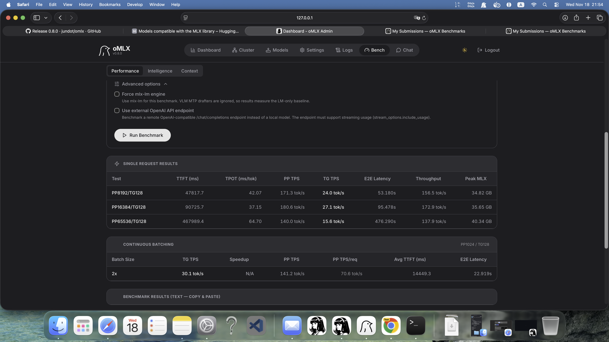
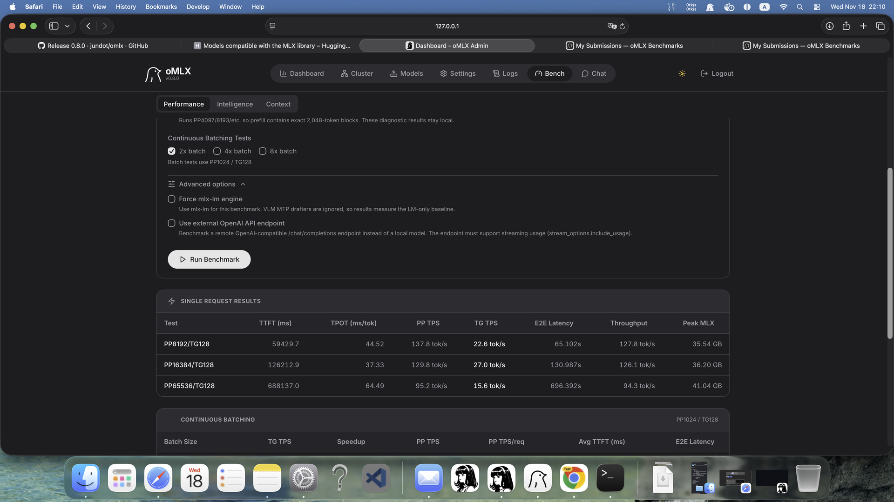
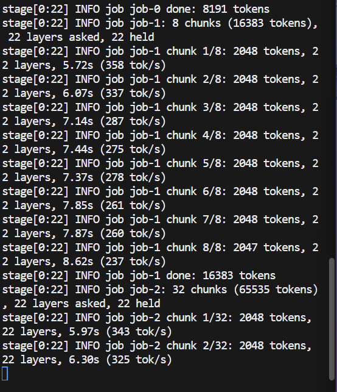
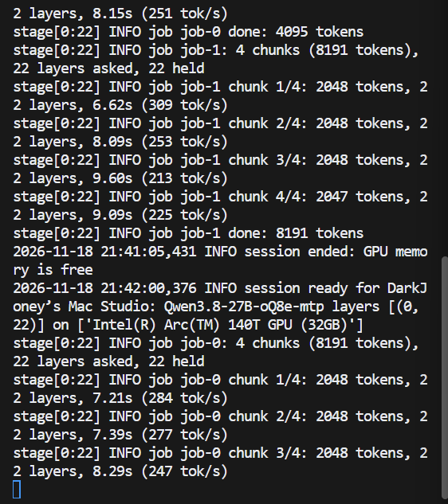
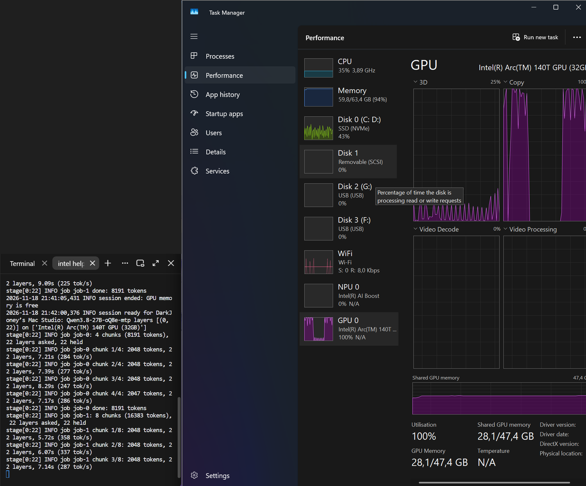
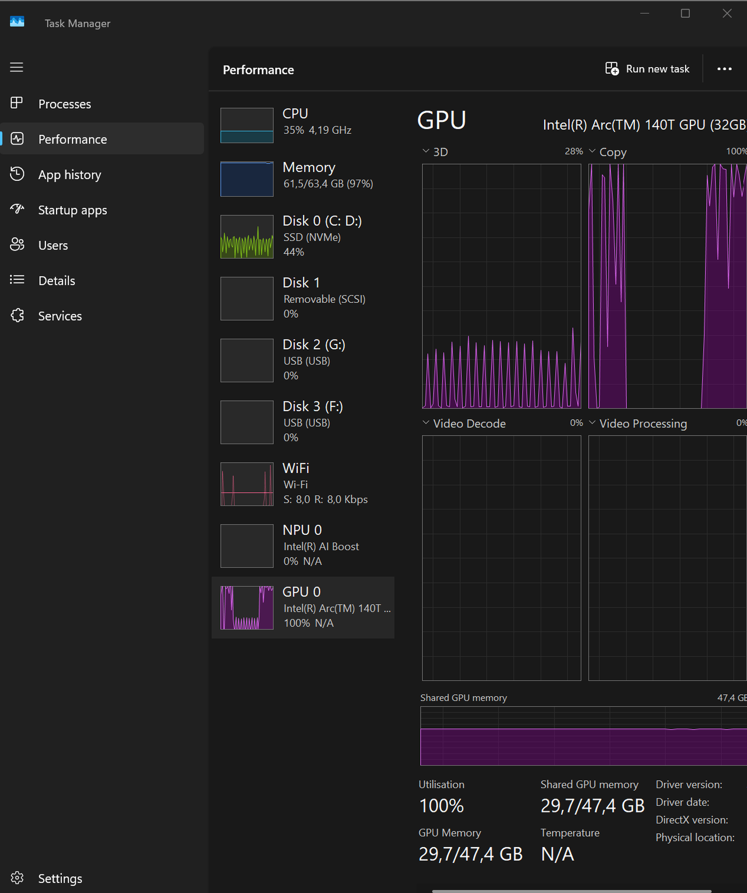
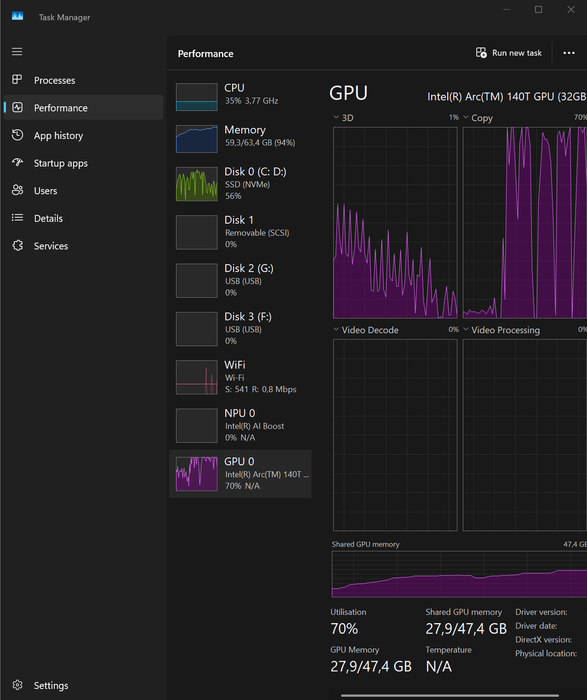
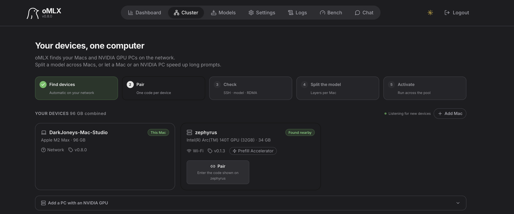
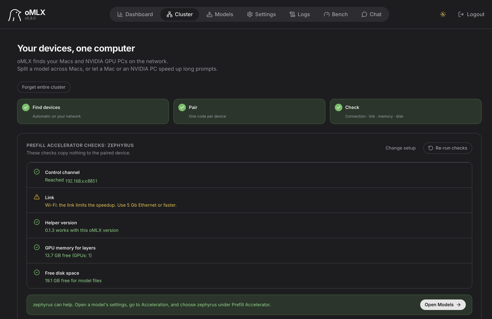
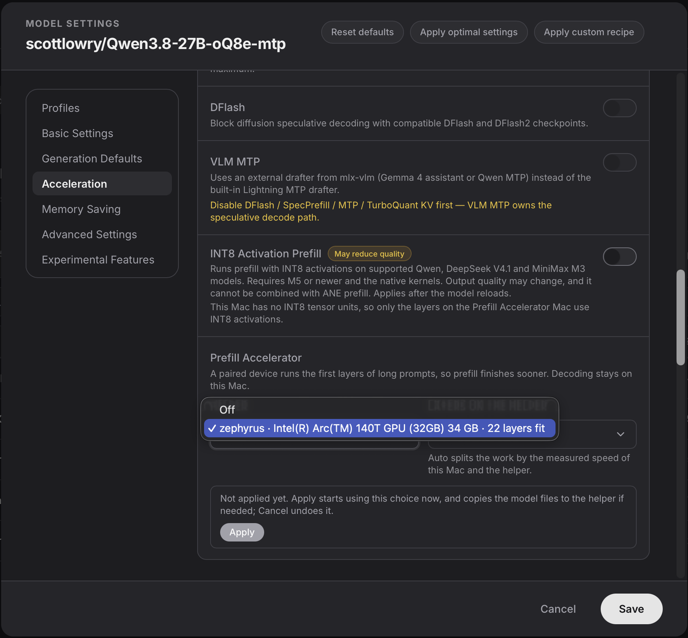

# Results

All numbers below come from oMLX's own *Bench* page (screenshots included), and from the helper's
own log. Nothing is estimated.

## Setup

| | |
|---|---|
| Host | Mac Studio, Apple M2 Max (38-core GPU), oMLX 0.8.0 |
| Model | Qwen3.8-27B, `oQ8e` 8-bit affine (28 GiB), 64 layers, 16 full-attention + 48 Gated DeltaNet |
| Helper | ASUS ROG Zephyrus G16, Core Ultra 9 285H, **Arc 140T iGPU**, 64 GB shared RAM, Windows 11 |
| Layers on the helper | 22 of 64 (forced in the oMLX model settings) |
| Link | **Wi-Fi 7, MLO mode, through a GL.iNet Flint 3 router** (no cable; oMLX still warns that Wi-Fi limits the speedup) |
| Chunk | 2048 tokens |
| Benchmark | oMLX Bench → Performance, PP 8192 / 16384 / 65536, TG 128 |

## Prefill and decode, Mac alone vs Mac + helper

| Test | PP alone | PP with helper | Speedup | TG alone | TG with helper |
|---|---:|---:|---:|---:|---:|
| PP8192  | 137.8 tok/s | 171.3 tok/s | +24 % | 22.6 | 24.0 |
| PP16384 | 129.8 tok/s | 180.6 tok/s | +39 % | 27.0 | 27.1 |
| PP65536 |  95.2 tok/s | 140.0 tok/s | +47 % | 15.6 | 15.6 |

Time to first token at 64k: 688 s alone, 468 s with the helper.

| With the helper | Mac alone |
|---|---|
|  |  |

## What the helper did (from its log)

The 22 layers it holds, 2048-token chunks:

| Context | Chunk speed of the helper's layers |
|---|---|
| first chunk of any job | 340–380 tok/s |
| 8k, last chunk | ~230 tok/s |
| 64k, last chunk | 68 tok/s |

| Chunks of a 16k and a 64k job | Session on the Arc 140T, then a job |
|---|---|
|  |  |

A single screenshot with the helper log (session created on the Intel Arc 140T, then chunks)
and Task Manager (GPU 0, Arc 140T, 100 %):

The helper's per-chunk time grows with the context (attention). Summed over the 32 chunks of the
64k job it is about 416 s, against 468 s for the whole run.

**Why the speedup is largest at 64k although the helper gets slower there.** Offloading 22 of 64
layers removes 42/64 of the work from the Mac, so the best possible speedup of this split is
64/42 = 1.52x (+52 %). At 64k we measured +47 %: close to that ceiling, because the Mac and the
helper are then nearly balanced (the Mac's 42 layers are about 450 s if layers cost the same, the
helper's 22 are about 416 s, and they overlap). At 8k the ceiling is not reached (+24 %) because fixed
costs (link, first chunk, start-up, 47.8 s measured against about 39 s for the Mac's share alone) are
a larger part of a short run. The Mac alone also loses 31 % of its speed from 8k to 64k, so there
is more to win at long context. The same balance means there is little slack left: with more layers
on the helper it would become the slower side, and its attention cost per layer keeps growing with
the context, so beyond this split the lever is faster attention, not more layers.

The GPU is busy while it works (3D engine for compute, Copy engine for the weights and the cache).
Windows Task Manager during two jobs:

| Arc 140T at 100 % | Arc 140T at 70 % |
|---|---|
|  |  |

## oMLX recognizes the helper

| Found nearby | Checks after pairing |
|---|---|
|  |  |

The LAN address of the control channel is masked in the second screenshot.

## What these numbers do not show

- **One run each.** No repeats, no error bars. The baseline was measured *after* the helper run, on
  the same Mac. Background load on either machine was not controlled.
- **Output equality is not verified yet** on a real model (same seed, greedy, with and without the
  helper). The stages match the Mac-recorded fixtures and a float32 MLX reference on tiny models,
  but 16-bit rounding differs slightly from Metal's, so a changed continuation on some prompt is
  expected at this level.
- 22 layers was forced by hand in the oMLX model settings. An earlier session ran 22 layers and the
  next one 4 without a cause in the helper log; that was not investigated.
- The Mac and the Windows clock differ by an hour in the screenshots; the order of events is
  consistent with the helper log.

## Negative results (so nobody repeats them)

| Idea | Outcome |
|---|---|
| `OMLX_HELPER_SDPA=1`: torch fused attention with a causal mask | Fast at 2k context, no faster than the plain path at 16k+, and it asks the allocator for a single 4.5 GiB block: both jobs died with *XPU out of memory* while 13 GiB was free. Stays off. |
| SDPA without a mask | 4× faster than the plain path at 16k–32k, but cannot be used alone: no causal mask on the fast path and the API does not return the log-sum-exp needed to merge a prefix part with a causal part. |
| int4 `_weight_int4pack_mm` | No faster than dequantize + GEMM on this iGPU. |
| int8 `_int_mm` (~21 TOPS) | Fast, but its numerics differ from the Mac's 16-bit prefill; not used. |
| Power plan *PD Silent* | Halves the GEMM speed. Use *Balanced* or better. |

Micro-benchmarks behind these rows are in [`intel-helper/bench`](../intel-helper/bench).

## Next

1. A flash-attention kernel with a causal mask for XPU (the long-context limit).
2. Output-equality check and repeated runs.
3. Wired link; the Ubuntu machine as the helper.
4. Qwen3.8 Flash-Next on real weights, grouped MoE GEMM.
